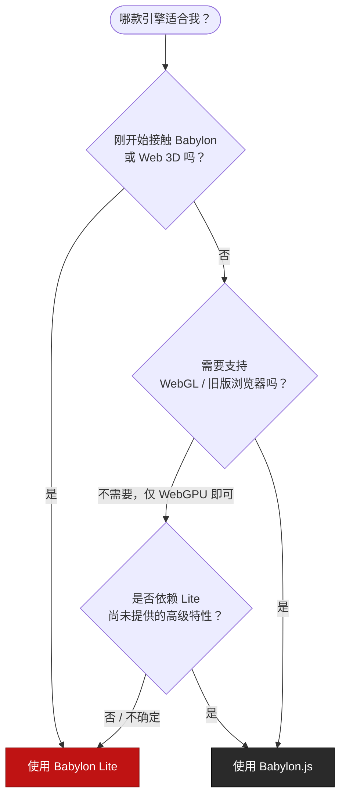

# 欢迎来到 Babylon Lite

Babylon Lite 是我们一直梦想打造的引擎——一个从零起步、没有历史包袱、直接构建在现代 GPU API 与现代工具链之上的 3D 引擎。

它是一个**专为 WebGPU 打造、支持 Tree-Shaking、面向数据（data-oriented）的渲染器**，旨在实现前所未有的极小打包体积与高性能——同时呈现出**与你熟知的 Babylon.js 像素级完全一致的精美渲染效果**。

> **Babylon Lite 并不是 Babylon.js 的替代品。** 两个引擎作为同一家族并肩前行，只是各自针对不同目标进行了优化——让你可以根据实际任务选择最合适的工具。

---

## 简而言之——我该使用哪个引擎？

| 如果你需要…                                                               | 请选择           |
| ------------------------------------------------------------------------- | ---------------- |
| 尽可能小的打包体积、最高的性能、按需打包（只打包你用到的功能）            | **Babylon Lite** |
| 最全面的功能集、同时支持 WebGL **与** WebGPU，以及稳健的向后兼容性        | **Babylon.js**   |
| 通过干净、无类（classless）的 API **在现代 Web 上学习 3D**                | **Babylon Lite** |
| **立即发布生产应用**，且依赖于完整的 Babylon 功能集                       | **Babylon.js**   |

还是不确定？请直接跳转至下方的[决策树](#选择你的引擎)。

---

## 什么是 Babylon Lite？

Babylon Lite 是面向现代 Web 对 3D 引擎的彻底重构，核心理念如下：

- **WebGPU 独占。** 零 WebGL 回退，没有历史兼容包装层，也不为旧 API 提供抽象层。Lite 完全围绕 WebGPU 范式构建——渲染管线（render pipelines）、计算着色器（compute shaders）、绑定组（bind groups）以及命令缓冲区（command buffers）。
- **无类设计——纯粹的数据 + 函数。** 相机、灯光、网格和材质都是普通的纯状态对象。行为逻辑位于独立的、可 Tree-Shaking 的函数中，例如 `getViewMatrix(camera)` 和 `addToScene(scene, entity)`。对象不携带隐藏引用，这意味着序列化非常简单、零循环依赖，并能实现最大限度的死代码消除。
- **极致的 Tree-Shaking。** 每个可选功能都是一个独立模块，仅在场景实际使用时才动态导入。**未使用的功能占零字节。** 一个简单场景只需几 KB；而复杂的 PBR + IBL 场景也只会为其实际触及的功能付费。
- **现代工具链。** 基于 Vite 构建，在生产包中对 WGSL 着色器进行压缩，并全程采用严格的现代 TypeScript。

### 视觉兼容——与 Babylon.js 像素级一致

这是我们最引以为傲的部分。**在相同的场景配置下，Babylon Lite 与 Babylon.js 会渲染出相同的像素。**

我们不是复制 Babylon.js 的代码，而是理解其背后的数学原理，并用最少的代码复现出完全一致的画面。每一个一致性（parity）场景都会在 CI 中通过自动化像素比对来对照 Babylon.js 的黄金参考图进行验证：每个场景会在两个引擎中分别渲染，并与不可变的 Babylon.js 截图计算每个颜色通道（0–255 范围）的**平均绝对差（MAD）**。我们整个测试集的中位 MAD 为 **0.05**——几乎无法用肉眼分辨——而且这一阈值会在每次代码变更时强制校验，绝非仅靠人工目测过一遍。

这意味着你可以同时获得 **Babylon.js 级别的画质与 Lite 的体积和速度**。

---

## 数据对比

以下数据在我们完整的一致性测试集（100+ 场景）中实时测得，对比的是在两个引擎中构建的完全相同的场景。

| 指标                         | Babylon Lite 对比 Babylon.js                                                      |
| ---------------------------- | --------------------------------------------------------------------------------- |
| **打包体积**（gzip 压缩 JS） | 平均 **缩小约 19 倍**（未压缩时缩小约 30 倍）；在聚焦单一能力的场景中**最高缩小 50 倍** |
| **帧耗时**（RAF CPU）        | **快约 3–4 倍**                                                                   |
| **启动时间**                 | **快约 2.5 倍**                                                                   |
| **内存占用**                 | **减少约 5 倍**                                                                   |
| **视觉输出**                 | 像素级一致（中位 MAD 为 0.05）                                                    |

以下方的 BoomBox PBR 场景为例，gzip 压缩后为 **34 KB 对比 675 KB**（未压缩为 84.5 KB 对比 2.8 MB）——画面完全相同，下载体积却只有几十分之一。

### 相同场景，并排对比


> _左：Babylon Lite。右：Babylon.js。相同的模型、相同的灯光、相同的 IBL——完全一致的结果，体积却只是零头。_

---

## 两个引擎中的同一场景

将场景迁移到 Babylon Lite 会让人感到十分熟悉。虽然 API 有所不同——没有类，行为存在于独立函数而非实例方法中——但它们在**形态与命名**上依然相似，因此相关概念可以直接迁移。

下面是上方展示的同一个 BoomBox PBR 场景在两个引擎中的代码对比。

### Babylon.js

```typescript
import { WebGPUEngine } from "@babylonjs/core/Engines/webgpuEngine";
import "@babylonjs/core/Helpers/sceneHelpers";
import { HemisphericLight } from "@babylonjs/core/Lights/hemisphericLight";
import { SceneLoader } from "@babylonjs/core/Loading/sceneLoader";
import { CubeTexture } from "@babylonjs/core/Materials/Textures/cubeTexture";
import { Vector3 } from "@babylonjs/core/Maths/math.vector";
import { Scene } from "@babylonjs/core/scene";
import "@babylonjs/loaders/glTF";

const engine = new WebGPUEngine(canvas, { antialias: true, adaptToDeviceRatio: true });
await engine.initAsync();
const scene = new Scene(engine);

const light = new HemisphericLight("hemi", new Vector3(0, 1, 0), scene);
light.intensity = 1.0;

await SceneLoader.ImportMeshAsync("", "https://playground.babylonjs.com/scenes/", "BoomBox.glb", scene);
scene.environmentTexture = new CubeTexture("https://assets.babylonjs.com/core/environments/environmentSpecular.env", scene);
scene.createDefaultCamera(true, true, true);
scene.createDefaultEnvironment({ createSkybox: true, createGround: true, skyboxSize: 1000 });

engine.runRenderLoop(() => scene.render());
```

### Babylon Lite

```typescript
import {
    createEngine,
    createSceneContext,
    createDefaultCamera,
    createHemisphericLight,
    loadGltf,
    loadEnvironment,
    addToScene,
    attachControl,
    registerScene,
    startEngine,
} from "@babylonjs/lite";

const engine = await createEngine(canvas);
const scene = createSceneContext(engine);

addToScene(scene, createHemisphericLight([0, 1, 0], 1.0));
addToScene(scene, await loadGltf(engine, "https://playground.babylonjs.com/scenes/BoomBox.glb"));
await loadEnvironment(scene, "https://assets.babylonjs.com/core/environments/environmentSpecular.env", {
    groundTextureUrl: "https://assets.babylonjs.com/core/environments/backgroundGround.png",
    skyboxUrl: "https://assets.babylonjs.com/core/environments/backgroundSkybox.dds",
    skyboxSize: 1000,
});

const cam = createDefaultCamera(scene);
attachControl(cam, canvas, scene);

await registerScene(scene);
await startEngine(engine);
```

请注意它们的结构如出一辙：创建引擎、构建场景、添加灯光、加载 glTF、配置环境和相机，然后运行。不同之处在于，Lite 提供的是**纯数据加上可 Tree-Shaking 的函数**，而不是类和实例方法——也正因如此，打包工具才能将你未使用的所有代码彻底剔除。

> 想不安装任何东西直接运行这段代码？把它粘贴到 **[Lite Playground](https://liteplayground.babylonjs.com)** 并点击 Run 即可。浏览完整功能请查看 **[Playground 指南](04-playground.md)**。

> 准备好迁移一个真实场景了吗？请查阅 **[迁移指南](03-porting-guide.md)** 获取完整的逐项 API 对照表。

---

## 选择你的引擎

使用这棵决策树来确定你的起点。没有所谓“错误”的选择——而且由于两者的 API 形态相近，你日后随时可以切换，并且无需担心画面像素会发生变化。



### 通俗总结

**在以下情况选择 Babylon Lite：**

- 你**刚刚开启 Babylon 之旅**——Lite 干净、无类的 API 是极佳的第一步，而且学到的概念之后可以直接迁移到 Babylon.js。
- **打包体积至关重要**——落地页、嵌入式组件、广告、电商页面、移动端 Web，或任何寸土寸金（按 KB 计）的场景。
- **性能至关重要**——你想在 WebGPU 硬件上获得最快的帧率、最快的启动速度与最低的内存占用。
- 你只面向**现代浏览器**，不需要 WebGL 回退。

**在以下情况选择 Babylon.js：**

- 你需要支持 **WebGL 或旧版浏览器**——Lite 在设计上仅支持 WebGPU。
- 你依赖**Lite 尚未覆盖的功能**——Babylon.js 拥有生态中最广泛、最成熟的功能集。
- 你需要**在今天就交付生产级应用**，并且需要一个稳定、经过充分实战检验的 API 界面。
- 你想要**完整的工具链箱**：完整的编辑器、Playground、Sandbox 以及整个扩展生态。

对于当今大多数项目来说，Babylon.js 依然是稳妥的默认选择。当你需要最小的打包体积和最高的性能，同时又要求与 Babylon.js 像素级一致的渲染结果时，Babylon Lite 就是你的答案。

---

## 温馨提示

以下是一些坦诚的说明，帮助你更有把握地做技术规划：

- **仅限 WebGPU。** Lite 可在任何支持 WebGPU 的环境中运行——Chrome 与 Edge 113+，以及较新版本的 Firefox 与 Safari。在设计上不提供 WebGL 回退。
- **API 尚年轻，仍在演进。** Lite 已完全开源且立即可用。我们非常欢迎早期采用者，但请注意在正式稳定前部分 API 仍可能调整。
- **向后兼容不是首要目标。** 这是为了换取极小体积与极高速度而刻意做出的权衡。相比 Babylon.js，Lite 有意保持更精简、更有主见的设计边界。
- **一个场景，一个引擎。** 它们是两个独立的引擎，因此单个场景只会基于其中之一构建。但因为两者的 API 形态相近，且 glTF、`.env` 和纹理等资产可直接通用，为项目挑选合适的引擎几乎没有风险。

---

## 常见问题

**它支持哪些浏览器？**
Babylon Lite 仅支持 WebGPU，因此可在任何支持 WebGPU 的浏览器中运行：Chrome 与 Edge 113+，以及较新版本的 Firefox 与 Safari。在设计上不提供 WebGL 回退。

**Babylon.js 的功能会进入 Lite 吗？**
会的——让 Lite 逐步实现与 Babylon.js 的功能对齐是我们的最高优先级。各项功能会以独立、可 Tree-Shaking 的模块形式加入，确保引擎成长的同时不会让你的打包体积膨胀。请查看**[功能对比](02-feature-comparison.md)**，准确了解当前已支持、部分支持以及尚未支持的功能。

**我可以在同一个项目中混用 Babylon.js 和 Babylon Lite 吗？**
单个场景只能使用其中一个引擎来构建。由于两者在 API 形态上很相似，相关的设计概念与资产（glTF、`.env`、纹理）都可以直接沿用，方便你为具体项目挑选更合适的引擎。

**它已经可以用于生产了吗？API 稳定吗？**
Lite 仍处于早期阶段，随着我们逐步补齐功能差距，API 仍可能演进。它已完全开源且当下即可使用——我们非常欢迎早期试用者，同时提醒在正式稳定前部分 API 可能会发生变动。

**“像素级一致”是指绝对逐比特相等吗？**
它指的是**肉眼无法分辨的视觉一致**，并由 CI 中针对每个场景的自动化 MAD 阈值来强制保证。目标是带来你用肉眼看不出区别的 Babylon.js 级别渲染输出。

---

## 未来展望

这仅仅是个开始。在我们的路线图上还有：

- **与 Babylon.js 的功能对齐**——不断缩小功能差距，让更多场景能够毫无妥协地用 Lite 构建。
- **Lite Viewer**——一个即插即用、极致轻量的查看器，以尽可能小的体积展示模型与场景。
- **Lite Sandbox**——为 Lite 重新构想的拖拽式模型检视工具。（**[Lite Playground](https://liteplayground.babylonjs.com)** 已经上线——今天就可以在浏览器中体验 Lite。）

同样重要的是：我们希望**听到你的声音**——还缺少什么功能、你在真正采用 Lite 前还需要什么，以及接下来它应该朝哪个方向发展。你的反馈将直接塑造路线图。

---

## 下一步

- 🚀 **[快速开始](01-getting-started.md)** — 安装 Lite、理解核心心智模型，并渲染你的第一个场景。
- 🛝 **[Lite Playground](04-playground.md)** — 零配置直接在浏览器中试用 Lite：在线编辑、运行并分享代码片段。
- 🔁 **[迁移指南](03-porting-guide.md)** — 逐行对照将 Babylon.js 场景转换为 Babylon Lite。
- 📊 **[功能对比](02-feature-comparison.md)** — 完整的 Lite 与 Babylon.js 功能矩阵，清晰了解已覆盖、部分支持和缺失的能力。
- 🧱 **[架构文档](architecture/00-overview.md)** — 深入引擎内部实现细节。
- 🧪 **[无头模式（Null Engine）](05-headless-null-engine.md)** — 在没有 GPU 的环境下运行 Lite，用于服务端物理与确定性模拟。
- 🫱 **[右手坐标系](07-right-handed-system.md)** — 以零额外开销将 Lite 编译为右手坐标系（对应 Babylon.js 的 `useRightHandedSystem`）。
- 🌐 **[github.com/BabylonJS/Babylon-Lite](https://github.com/BabylonJS/Babylon-Lite)** — 浏览源码、查看场景画廊并关注开发动态。

欢迎给仓库点个 Star、提交 Issue，并告诉我们你在选择 Lite 前还期待哪些能力。**双引擎，同家族，携手前行**——挑选契合你项目的引擎，安心切换，画面始终如一。💙
