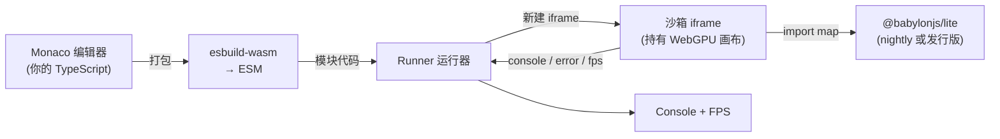

# Babylon Lite Playground

**[Lite Playground](https://liteplayground.babylonjs.com)** 是体验 Babylon Lite 最快捷的方式。你可以在其中编写带有完整 IntelliSense 的 TypeScript 代码，在 WebGPU 画布上实时运行，并将结果保存和分享为链接——一切都在浏览器中完成，**无需安装任何东西**。

> 🌐 **立即打开：[liteplayground.babylonjs.com](https://liteplayground.babylonjs.com)**

> **测试版（Beta）。** Lite Playground 目前处于 Beta 阶段——在体验逐步稳定前，可能会遇到一些小瑕疵以及偶尔的破坏性变更。

> 初次接触 Lite？请先阅读**[欢迎页](00-welcome.md)**了解整体图景，以及**[快速开始](01-getting-started.md)**掌握核心心智模型。Playground 正是你无需搭建本地项目即可动手实践这套心智模型的地方。

---

## 使用要求

- **支持 WebGPU 的浏览器** — Chrome/Edge 113+，以及较新版本的 Firefox 与 Safari。Babylon Lite 仅支持 WebGPU，因此 Playground 亦然。
- 就这些。不需要 Node，不需要打包工具，也不需要 `npm install`——编辑器、编译器和引擎全部运行在你的浏览器中。

---

## 为什么使用它？

- **零配置。** 跳过安装与配置步骤，直接开始编写场景代码。
- **边做边学。** 加载一个内置示例，微调代码并点击 **Run** 即可看到效果——这是学习 API 最短的反馈闭环。
- **完整的 IntelliSense。** 编辑器接入了 Babylon Lite 真实的类型定义，因此自动补全、悬停文档和行内报错都直接对应实际的引擎 API。
- **即时分享。** 保存代码片段即可获得永久链接，你可以直接贴到 Issue、论坛帖子或 Bug 报告中——底层使用与经典 Babylon Playground 相同的片段存储服务。

---

## 如何使用

### 编写与运行

Playground 打开后会载入一个入门示例场景。在左侧窗格编辑 TypeScript 代码，然后按 **Run**（▶ 按钮，或 **Ctrl/Cmd + Enter**），即可在右侧的 WebGPU 画布上执行。每次运行都会从干净状态重新开始，因此你永远不需要刷新整个页面。

你的代码直接从裸模块标识符 `@babylonjs/lite` 导入，并通过 id 获取画布——与真实应用完全一致：

```typescript
import { createEngine, createSceneContext, /* … */ } from "@babylonjs/lite";

async function main() {
    const canvas = document.getElementById("renderCanvas") as HTMLCanvasElement;
    const engine = await createEngine(canvas);
    const scene = createSceneContext(engine);
    // … build your scene, then register and start …
}

main().catch((err) => console.error(err));
```

所有 `console.log` 输出都会显示在 **Console** 面板中，预览区右上角还配有实时 **FPS** 读数和**全屏**切换按钮。

### 内置示例

工具栏中的 **Examples** 下拉菜单预置了多种开箱即用的场景——从极简入门示例到 PBR、物理以及多文件项目。任选其一作为起点并进行修改，运行示例是了解某项功能端到端工作方式的最快途径。

### 多文件项目

项目可以跨多个文件组织，就像经典 Playground 的多文件代码片段一样。编辑器上方的标签栏支持**新增**（`+`）、**重命名**（双击标签）和**删除**（`×`）文件，标签上的圆点标记了运行器（runner）进行打包时的**入口（entry）**文件。文件之间可通过相对路径互相导入：

```typescript
import { buildScene } from "./scene";
```

### 导入 npm 包

除 `@babylonjs/lite` 之外的任何裸包导入都会在运行时通过 [esm.sh](https://esm.sh) CDN 解析，因此外部 ESM 包无需任何配置即可使用：

```typescript
import seedrandom from "seedrandom"; // resolved from esm.sh automatically
```

而 `@babylonjs/lite` 本身则会固定为你所选择的引擎版本（见下文）。

### 选择引擎版本

**Engine version** 下拉菜单用于选择运行器加载哪一个 Babylon Lite 构建版本：

- **Nightly（最新源码）** — 直接基于仓库最新代码构建的引擎版本，让你可以在正式发布前抢先体验最新改动。
- **已发布的正式版本** — 任意 npm 上的历史或最新版本，按需从 esm.sh 获取。

这使你既可以针对某个特定发行版复现 Bug，也可以确认修复是否已经合入 nightly 构建。

### 保存、分享与下载

- **Save**（软盘图标）会保存你的项目并将永久链接复制到剪贴板。对已加载的代码片段再次保存时，会在同一链接下创建一个新修订版（revision）。**Save with details…**（下拉小箭头）还可以同时填写标题、描述和标签。
- **Download**（向下箭头图标）会将整个项目导出为一个自包含的可运行 zip 压缩包：包含 `index.html`、打包好的 `main.js` 以及它引用的所有本地资产。直接架设静态目录服务器即可按 Playground 中的相同效果运行。

资源文件建议使用绝对 `https://` URL（例如 `https://assets.babylonjs.com/…`）进行引用，以确保在任何环境下都能正常解析。

---

## 工作原理

Playground 从不将你的代码发送到服务器进行编译，所有流程全部在客户端本地完成：

1. **编写代码**：你在 Monaco 编辑器（即驱动 VS Code 的同款编辑器）中编写 TypeScript，编辑器加载了 Babylon Lite 真实的 `.d.ts` 类型声明，确保 IntelliSense 与引擎完全一致。
2. **浏览器内转译**：Playground 使用 `esbuild-wasm` 在浏览器内对你的文件进行转译，从入口文件开始打包，内联所有相对路径导入，保留 `@babylonjs/lite` 为外部依赖，并将其他裸模块导入重写为 esm.sh URL。
3. **沙箱 iframe 运行**：打包后的模块会在一个全新的沙箱 iframe 中执行，该 iframe 拥有独立的 WebGPU 画布，并通过 import map 将 `@babylonjs/lite` 映射到你所选的引擎版本。由于每次运行都会重建 iframe，出错的场景绝不会污染外围 UI——只需修改代码再重新运行即可。
4. **状态回传**：iframe 通过 `postMessage` 将控制台输出、运行时错误和 FPS 回传给外壳页面，由外壳展示在 Console 和 FPS 面板中。



总而言之，Playground 是一个真正自包含的 Babylon Lite 应用构建器，完全在你的本机浏览器中完成编译与运行——你在这里写下的代码，可以原封不动地复制到通过 `npm install @babylonjs/lite` 初始化的本地项目中运行。

---

## 嵌入式集成

Playground 可以作为 iframe 嵌入到其他页面中——例如文档站、博客或经典 Babylon Playground——并通过一组简洁的 `postMessage` API 控制代码加载与运行。文档中的可交互实时示例正是通过这种方式托管的。

### 1. 插入 iframe

```html
<iframe src="https://liteplayground.babylonjs.com/?embed=runner" title="Babylon Lite Playground" style="width: 100%; height: 480px; border: 0"></iframe>
```

通过 `?embed=` 选择嵌入模式：

- **`runner`** — 仅展示画布 + 控制台，不带编辑器。最适合文档和演示。
- **`split`**（也可写为 `?embed` 或 `?embed=1`）— 在画布旁展示一个紧凑型编辑器，方便读者亲自修改代码。

可选地添加 `?embedOrigin=https://your-site.example`，以限制嵌入页仅接收来自指定来源的消息并仅向该来源发送事件（默认值为 `*`）。在生产环境中建议将其设为你的站点来源，确保只有你的页面能够驱动该 iframe。

### 2. 通过 `postMessage` 通信

宿主页面与嵌入页通过 `window.postMessage` 通信。**每条消息都携带 `channel: "babylon-lite-playground"`**——请在收发两端都校验该字段，以免与页面上的其他 iframe 消息发生冲突。

**宿主页面向嵌入页发送的指令：**

| `type`     | 字段           | 作用                                                         |
| ---------- | -------------- | ------------------------------------------------------------ |
| `loadCode` | `code`, `run?` | 替换入口文件的内容；若 `run` 为 true 则立即执行              |
| `run`      | —              | 运行当前代码                                                 |
| `dispose`  | —              | 销毁正在运行的场景                                           |
| `getCode`  | —              | 请求入口文件的内容（嵌入页会回复一条 `code` 事件）           |

**嵌入页向宿主页面回传的事件：**

| `type`    | 字段            | 触发时机                               |
| --------- | --------------- | -------------------------------------- |
| `ready`   | `mode`          | 嵌入页已完成初始化并可接收指令         |
| `console` | `level`, `text` | 代码片段输出了一行 `console.*`         |
| `error`   | `text`          | 发生未捕获的运行时错误                 |
| `stats`   | `fps`           | 运行期间大约每秒触发一次               |
| `ran`     | —               | 一次运行已完成模块导入                 |
| `code`    | `code`          | 对 `getCode` 请求的回复                |

> **发送任何指令前请先等待 `ready` 事件。** 嵌入页在完成启动并发出 `ready` 之前无法接收指令，在此之前发送的 `loadCode` 会被丢弃。

### 3. 完整的宿主页面示例

下面的示例会在 iframe 就绪后立即将你的自定义代码注入并运行，同时把代码片段的控制台输出与 FPS 同步到宿主页面：

```html
<iframe id="pg" src="https://liteplayground.babylonjs.com/?embed=runner&embedOrigin=https://your-site.example"
        title="Babylon Lite Playground" style="width: 100%; height: 480px; border: 0"></iframe>

<script type="module">
    const frame = document.getElementById("pg");
    const channel = "babylon-lite-playground";

    const myCode = `import { createEngine, createSceneContext, createArcRotateCamera, attachControl,
    createHemisphericLight, createSphere, createPbrMaterial, addToScene,
    registerScene, startEngine } from "@babylonjs/lite";

async function main() {
    const canvas = document.getElementById("renderCanvas");
    const engine = await createEngine(canvas);
    const scene = createSceneContext(engine);

    const camera = createArcRotateCamera(-Math.PI / 2, Math.PI / 2.5, 4, { x: 0, y: 0, z: 0 });
    scene.camera = camera;
    attachControl(camera, canvas, scene);

    addToScene(scene, createHemisphericLight([0, 1, 0], 1.0));

    const sphere = createSphere(engine, { segments: 16, diameter: 2 });
    sphere.material = createPbrMaterial({ baseColorFactor: [0.9, 0.1, 0.1, 1], roughnessFactor: 0.4 });
    addToScene(scene, sphere);

    await registerScene(scene);
    await startEngine(engine);
}
main().catch((err) => console.error(err));`;

    // Send a command to the embed.
    function post(msg) {
        frame.contentWindow.postMessage({ channel, ...msg }, "*");
    }

    // Listen for events coming back from the embed.
    window.addEventListener("message", (e) => {
        if (e.data?.channel !== channel) return;
        switch (e.data.type) {
            case "ready":
                post({ type: "loadCode", code: myCode, run: true });
                break;
            case "console":
                console.log(`[playground:${e.data.level}]`, e.data.text);
                break;
            case "error":
                console.error("[playground error]", e.data.text);
                break;
            case "stats":
                // e.data.fps — e.g. update an on-page FPS badge
                break;
        }
    });
</script>
```

要在编辑后重新运行，请发送 `{ type: "run" }`；要停止场景，请发送 `{ type: "dispose" }`；要读回用户在 `split` 模式下输入的代码，请发送 `{ type: "getCode" }` 并处理返回的 `code` 消息。

### 多文件项目

`loadCode`/`getCode` 属于**单文件**操作——它们只作用于入口文件。若要将完整的多文件项目交给独立版 Playground 打开，请使用嵌入页中的 **Open in Lite Playground** 按钮，它会通过深度链接（deep link）携带全部文件：

- `/snippet/<id>/v/<rev>` — 已保存的代码片段（规范的永久链接）。
- `#code=<base64url>` — 内联项目（项目 JSON 的 base64url 编码），用于在尚未保存时传递。

---

## 下一步

- 🚀 **[快速开始](01-getting-started.md)** — 了解在 Playground 中编写的代码背后的心智模型。
- 🔁 **[迁移指南](03-porting-guide.md)** — 将 Babylon.js 场景转换为 Lite，然后直接粘贴到 Playground 中运行。
- 📊 **[功能对比](02-feature-comparison.md)** — 了解 Lite 当前已支持的功能，明确哪些代码可以直接运行。
- 🌐 **[github.com/BabylonJS/Babylon-Lite](https://github.com/BabylonJS/Babylon-Lite)** — 查看源码，包括位于 `playground/` 目录下的 Playground 本身。

做出了值得分享的作品，或遇到了不好用的地方？保存代码片段并**[提交 Issue](https://github.com/BabylonJS/Babylon-Lite/issues)**——早期反馈将直接影响项目路线图。💙
